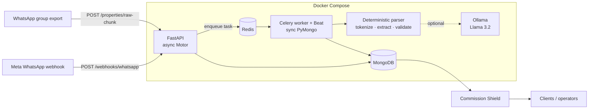
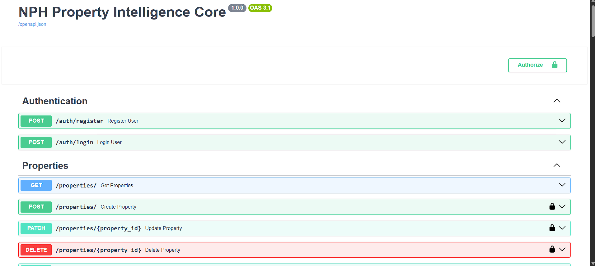

# NPH Property Intelligence Platform


A backend that turns messy, mixed Marathi/English WhatsApp broker messages into clean, deduplicated property listings, and matches them to buyer leads.

In Indian real-estate markets like Nashik, most inventory never reaches a listings portal. It gets posted as free text in dozens of WhatsApp broker groups, then copied and forwarded between them. This platform ingests those raw chat exports, extracts structured listings with a deterministic parser (plus optional local LLM enrichment), rejects spam and "wanted" posts, deduplicates forwarded copies, and serves the results through a role-aware API.

```text
INPUT  (raw WhatsApp export)                         OUTPUT  (stored listing)
──────────────────────────────────────────────       ──────────────────────────────────
[10:48 am, 27/06/2026] +91 90000 00001:              { "title": "2 BHK Apartment",
👉 नवीन 2 BHK फ्लॅट विकणे आहे 40 लाख सर्व खर्चा सोबत     "listing_type": "sale",
कार्पेट 1000 sq ft, इंदिरा नगर                           "bhk": 2,
संपर्क 9000000001                                      "price": 4000000,
                                                       "carpet_area_sqft": 1000,
                                                       "broker_phone": "9000000001" }
```

## Why it's harder than it looks

| Problem | What the pipeline does |
|---|---|
| **Mixed scripts and Indian units.** "40 लाख", "1.21 Cr", "400 ते 500 वार", "13k" | A deterministic tokenizer converts lakh, crore, k, vaar and guntha (in Latin or Devanagari script) into rupees and square feet |
| **Noise.** Event promos, workshop ads and "requirement" posts sit next to listings | A spam pre-filter plus intent detection route requirements away from inventory |
| **LLM hallucination.** A model can turn "40 lakh" into 4 crore | Deterministic values are ground truth and overwrite LLM output. Semantic validators reject impossible combinations (e.g. a crore-level *rent*) |
| **Hyper-duplication.** The same flat is forwarded across 20 groups with different wording | A structural SHA-256 fingerprint over `price + area + bhk + listing_type + broker_phone` merges copies instead of inserting duplicates |
| **Disintermediation.** Showing broker phones to clients lets them bypass the business | The **Commission Shield** blanks contact details and exact location for `PUBLIC` users |
| **Stale inventory.** Rentals go in days, commercial assets last for months | A Celery Beat sweeper applies different decay rules per listing type and lowers confidence scores |

## Architecture



1. **Ingest:** the API hashes the payload for idempotency, stores the raw text and returns `202` immediately.
2. **Split and filter:** the worker splits the export into messages and drops spam and requirement posts.
3. **Extract:** `CategoryAExtractor` pulls price, BHK, area, phone and intent. With `LLM_ENABLED=true`, a local Llama 3.2 adds locality, title and amenities, and the deterministic values still take priority.
4. **Validate and route:** semantic validators check each listing, then route it to `properties`, `pg_listings`, agricultural land or out-of-region collections.
5. **Deduplicate:** the structural hash merges forwarded copies, and each broker gets a profile with a reliability score.
6. **Serve:** search, lead matching, site-visit booking (multi-document transactions) and analytics, all filtered through role-based field masking.

More detail: [Architecture](docs/architecture/ARCHITECTURE.md) · [System design](docs/architecture/SYSTEM_DESIGN.md) · [Engineering decisions](docs/architecture/ENGINEERING_DECISIONS.md) · [Tech stack](docs/architecture/TECH_STACK.md) · [Roadmap](docs/architecture/ROADMAP.md)

## Quick start

Requires Docker Desktop. No cloud accounts, GPU or model downloads needed.

```bash
git clone https://github.com/Bhushan-Ahiree/nph-platform.git
cd nph-platform
cp .env.example .env            # then set JWT_SECRET and the two passwords

docker compose up -d --build    # api, worker, redis, mongo
docker compose exec api python scripts/seed_users.py   # creates admin + bot accounts
docker compose exec api python scripts/demo.py         # ingests the sample export
```

The demo sends [`data/samples/sample_whatsapp_dump.txt`](data/samples/sample_whatsapp_dump.txt) through the pipeline:

```text
1. Sending 1154 chars of raw WhatsApp text to POST /properties/raw-chunk
   -> 202 accepted: Raw group dump accepted. AI extraction queued for 'Sample Nashik Property Group'.
2. Waiting for the Celery worker to parse, validate and deduplicate...
3. 6 structured listing(s) in the database:

   TITLE                        TYPE   BHK    PRICE (INR)  AREA
   3 BHK Apartment              sale     3     12,100,000  Unknown
   Plot                         sale     0    125,000,000  Unknown
   2 BHK Apartment              sale     2      4,000,000  Unknown
   Commercial                   sale     0      3,500,000  Unknown
   1 BHK Apartment              rent     1          9,000  Unknown
   3 BHK Villa                  rent     3         13,000  Unknown
```

Eight messages produce six listings: the "wanted" post and the fashion-show ad are filtered out. Then open **http://localhost:8000/docs** for the interactive API, and log in with the admin account from your `.env`.



> `AREA` shows `Unknown` in deterministic-only mode. Locality extraction comes from the LLM pass.

### Optional: LLM enrichment

```bash
# in .env: LLM_ENABLED=true and OLLAMA_BASE_URL=http://ollama:11434
docker compose --profile llm up -d
docker compose exec ollama ollama pull llama3.2
```

### Connecting to the local MongoDB

From your host, use `mongodb://localhost:27018/?directConnection=true` (e.g. in MongoDB Compass).

## Running the tests

```bash
pip install -r requirements-dev.txt
pytest
```

The suite (300+ tests) runs against an in-memory MongoDB mock, so it needs no running services. It covers the parser, validators, ingestion pipeline, matching engine, Commission Shield, site-visit transactions and API routes.

## Project structure

```text
apps/
  api/         FastAPI app: routers, repositories (data access), Pydantic schemas
  worker/      Celery tasks: ingestion pipeline, webhooks, WhatsApp, maintenance sweeps
  scraper/     HTML listing scraper (optional `scraper` compose profile)
services/      Domain logic: matching engine, lead scoring, Commission Shield, WhatsApp client
shared/utils/  Deterministic parser, chunking, normalisation, validators, auth, database
data/samples/  Synthetic WhatsApp export used by the demo and tests
docs/          Architecture and design documentation
scripts/       Seed, demo, ingestion and backfill utilities
tests/         Pytest suite
```

## Tech stack

**API:** FastAPI, Pydantic v2, Motor (async MongoDB) · **Workers:** Celery + Beat, Redis · **Storage:** MongoDB (replica set for transactions) · **AI:** Ollama + Llama 3.2 (optional, local) · **Auth:** JWT + bcrypt · **Infra:** Docker Compose · **Tests:** pytest, pytest-asyncio

## Status

The platform was piloted in a real-estate advisory workflow in Nashik, where it was used on live broker group exports. It is not in active use right now, and development continues as a personal project. The repository ships only synthetic sample data. Planned next steps are tracked in the [roadmap](docs/architecture/ROADMAP.md).

## Author

**Bhushan Ahire**: [LinkedIn](https://www.linkedin.com/in/bhushan-ahiree/) · [bhushan.ahire.dev@gmail.com](mailto:bhushan.ahire.dev@gmail.com) · [GitHub](https://github.com/Bhushan-Ahiree)

## License

[MIT](LICENSE) © Bhushan Ahire
